<p align="center">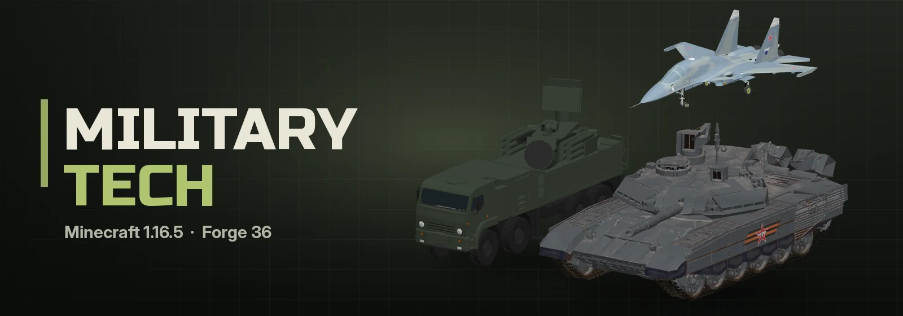</p>

<p align="center"><b>English</b> | <a href="README.ru.md">Русский</a></p>

<p align="center">
  
  
  
  
  
</p>

<p align="center">
  <a href="https://discord.gg/YOUR_INVITE"></a>
  <a href="https://t.me/qwarwin4git"></a>
  <a href="mailto:qwarwin@gmail.com"></a>
</p>

Military vehicles for Minecraft 1.16.5 on Forge 36: tanks, IFVs, rocket artillery, self-propelled guns, air defense
and jets. Made to play with friends, not as a simulator: a tank reloads in a few seconds and a jet does 70 blocks per
second. The vehicles are real 3D models with seats, interiors and working cockpits.

## Gallery

<table>
  <tr>
    <td width="50%" align="center">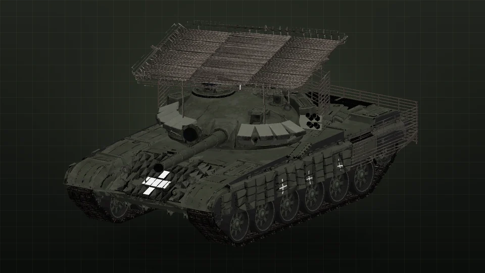<br><sub><b>T-72B3</b></sub></td>
    <td width="50%" align="center">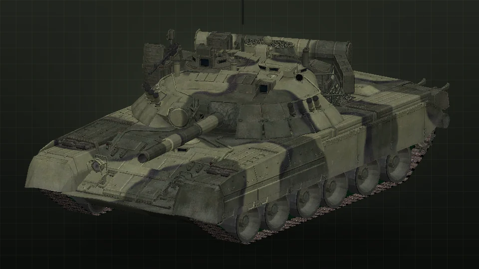<br><sub><b>T-80U</b></sub></td>
  </tr>
  <tr>
    <td width="50%" align="center">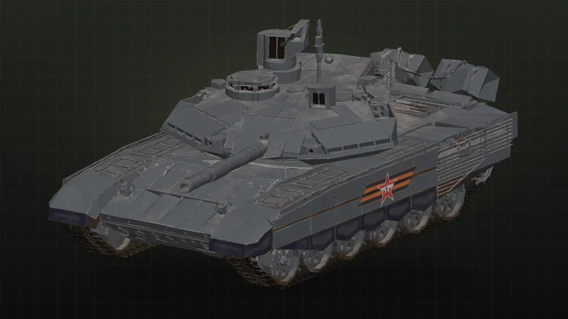<br><sub><b>T-90M Proryv</b></sub></td>
    <td width="50%" align="center">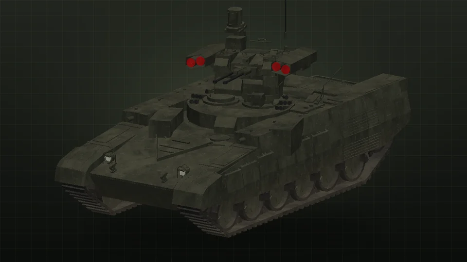<br><sub><b>BMPT Terminator</b></sub></td>
  </tr>
  <tr>
    <td width="50%" align="center">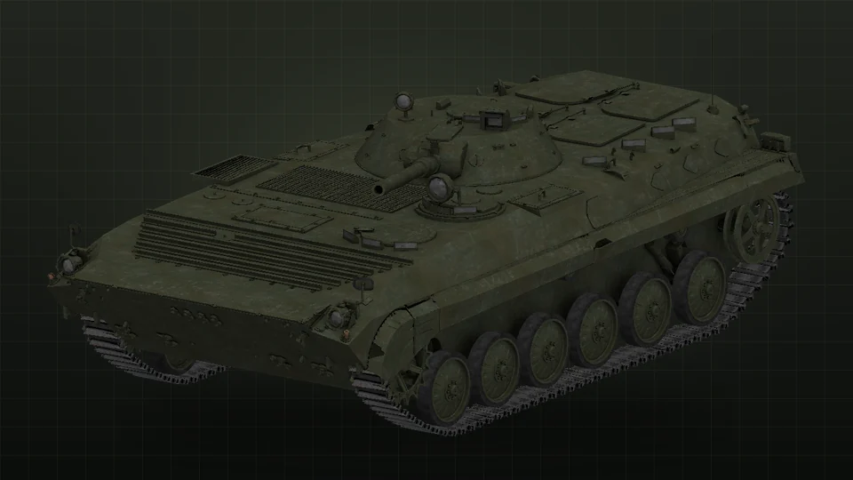<br><sub><b>BMP-1</b></sub></td>
    <td width="50%" align="center">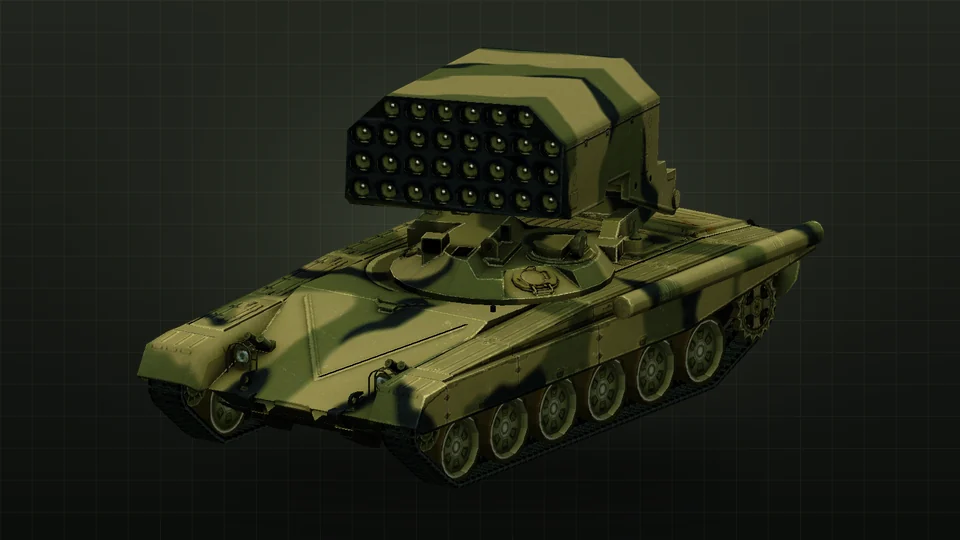<br><sub><b>TOS-1A Solntsepyok</b></sub></td>
  </tr>
  <tr>
    <td width="50%" align="center">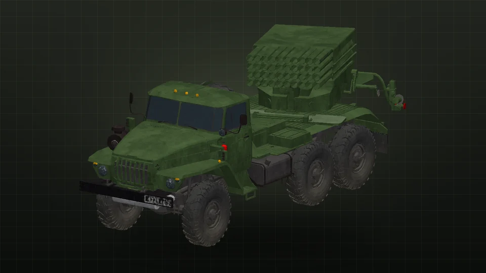<br><sub><b>BM-21 Grad</b></sub></td>
    <td width="50%" align="center">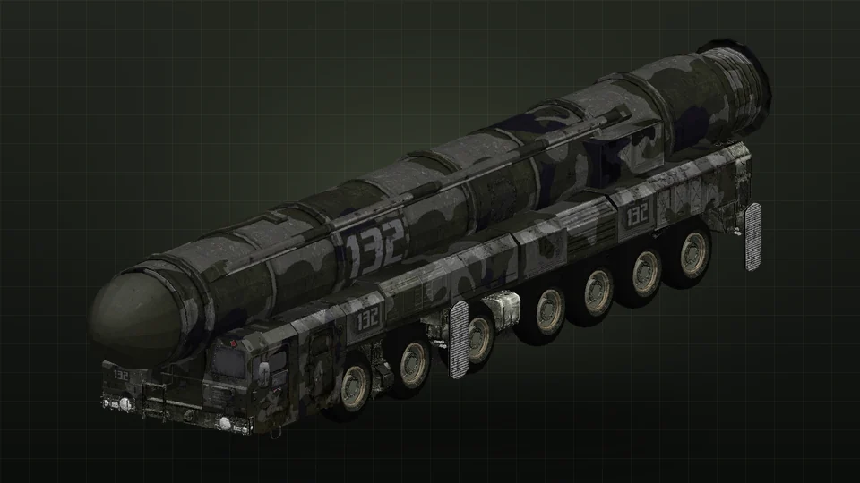<br><sub><b>Oreshnik</b></sub></td>
  </tr>
  <tr>
    <td width="50%" align="center">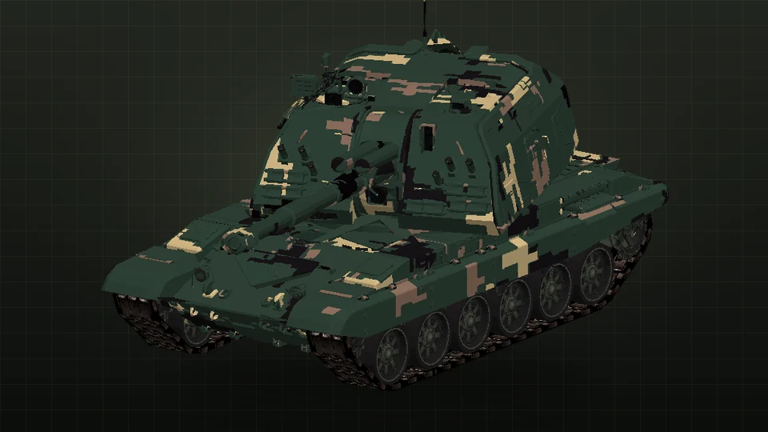<br><sub><b>2S19 Msta-S</b></sub></td>
    <td width="50%" align="center">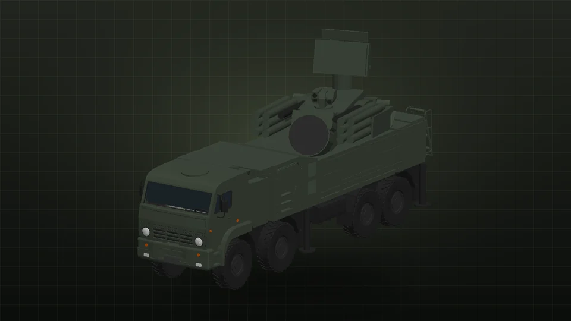<br><sub><b>Pantsir-S1</b></sub></td>
  </tr>
  <tr>
    <td width="50%" align="center">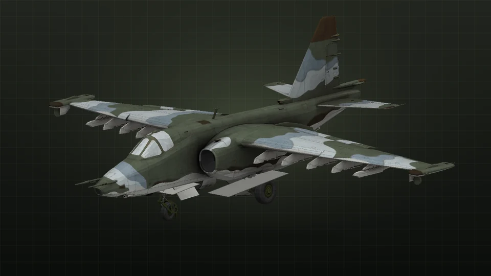<br><sub><b>Su-25</b></sub></td>
    <td width="50%" align="center">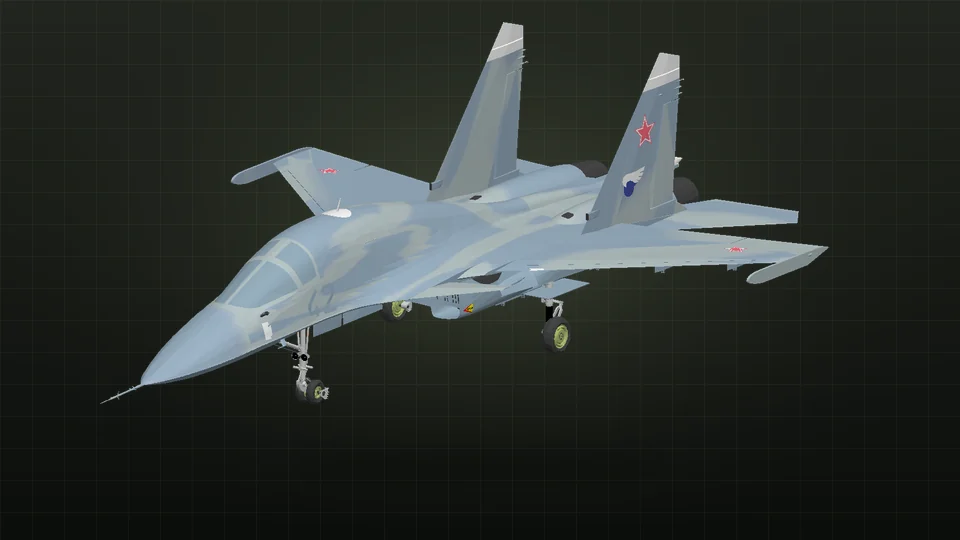<br><sub><b>Su-34</b></sub></td>
  </tr>
  <tr>
    <td width="50%" align="center">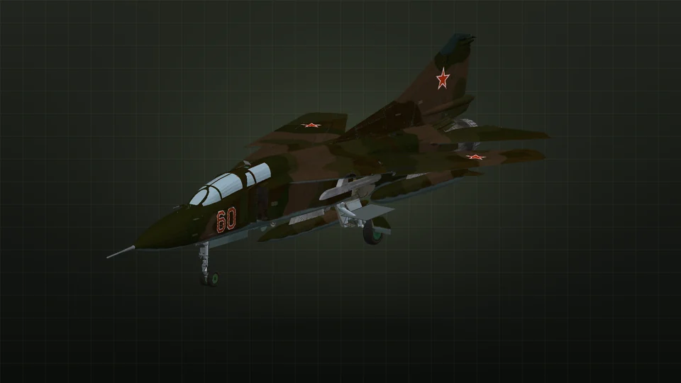<br><sub><b>MiG-23UB</b></sub></td>
    <td width="50%" align="center">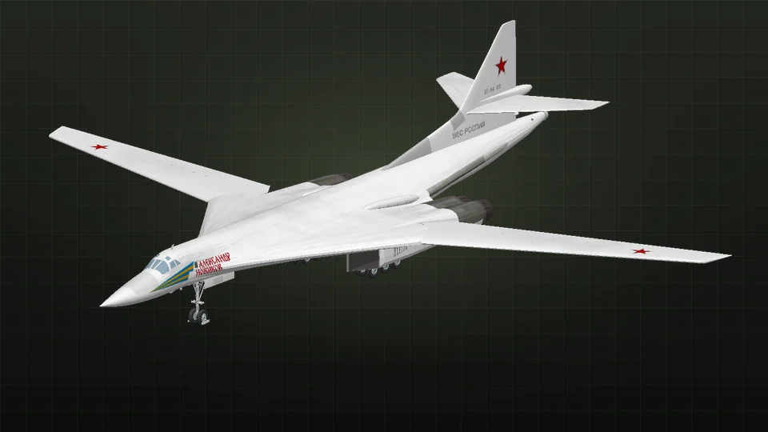<br><sub><b>Tu-160 White Swan</b></sub></td>
  </tr>
</table>

## What's inside

### Tanks and armor

- **T-72B3.** 125 mm 2A46M-5 with APFSDS, HE-frag and the guided Refleks, coaxial PKT, Kontakt-5 ERA.
- **T-80U.** Gas turbine, the fastest thing on tracks.
- **T-90M Proryv.** Relikt ERA, cage armor on the turret, the toughest of the three and the fastest to reload.
- **BMPT Terminator.** Two 30 mm 2A42 and four Ataka ATGMs.
- **BMP-1.** 73 mm Grom and a Malyutka on the rail, crew and dismounts inside, more troops ride on the roof. Swims.

Third person view has a third step: inside the vehicle. You see the fighting compartment with the crew seats, the
breech and the autoloader, the troop bay of the BMP and the truck cabs; the outside is visible through the vision
slits. Tanks and the BMPT also carry riders on the hull, unprotected but free to use their own weapons.

### Artillery

- **BM-21 Grad** on a Ural: 40 rockets, a full salvo (LMB) or one at a time (RMB), aimed by hand or at coordinates (R).
- **TOS-1A Solntsepyok.** A pack of 30 thermobaric rockets on a T-72 chassis, fired at coordinates. The thermobaric
  warhead works in two phases like the real one: a fuel cloud spreads along the ground and flows into trenches, doors
  and windows, then ignites as a whole a second later. Walls don't help inside the cloud, the blast wave hits outside.
- **2S19 Msta-S.** 152 mm self-propelled howitzer, HE-frag only, elevation −4…+68°, fires at coordinates out to
  ~3000 blocks. G switches between direct and high-angle fire.
- **Oreshnik** on an MZKT chassis: raise the container (G), set the coordinates (R), launch (LMB). The missile climbs,
  and a few seconds later six glowing reentry vehicles fall on the target, each splitting into six submunitions.
- **Nuclear warhead for the Oreshnik.** A separate item, installed with RMB on the launcher and chosen in the aiming
  window. Flash, crater, blast wave, fires, a mushroom cloud and fallout near ground zero; the whole server is told
  about the launch. Ammo crates don't restock it, the crater and blast size are configurable.

### Air defense

- **Pantsir-S1** on a KamAZ: 12 SAMs out to 1800 blocks and twin 30 mm guns. G turns on the automatic mode: it finds
  and shoots down aircraft, drones and missiles by itself.
- **AA gun turret 2×30 mm.** Placed on the ground, works on its own: airburst shells against hostile aircraft, missiles
  and drones within ~180 blocks. A small fast drone is hard to hit, a jet much easier.
- **SAM turret.** 8 missiles, engages hostile aircraft out to ~450 blocks (and Shaheds from FPV Drones).
- Turrets leave your own stuff alone: the owner and their `/team` count as friends. RMB turns a turret on and off.

### Aircraft

Controls are War Thunder style: the jet flies where you look.

- **Su-25.** GSh-30-2; Assault, Rockets, 8×FAB-500 and Anti-tank (Kh-29L) loadouts.
- **Su-34.** GSh-301; Strike (Kh-59, Kh-29, FAB), Heavy (FAB-1500) and **168 × S-8KO** rockets.
- **MiG-23UB.** Interceptor (R-40 + R-73), Dogfight (4×R-73), 4×FAB-500 or four B-8 rocket pods.
- **Tu-160 White Swan.** Strategic missile carrier with internal bays: 12 Kh-101 cruise missiles, a nuclear
  Kh-102 mix, FAB-3000/FAB-9000 or a carpet of 48 FAB-500. K in flight sets the target coordinates; the bomb sight
  puts the jet on a bomb run.
- **Ka-52 Alligator.** Coaxial attack helicopter at real size, with its own flight model: the rotors spool up, Space
  climbs, Ctrl descends, W/S tilt the nose to fly forward and back, A/D slide sideways, the mouse turns it; let go and
  it hovers. The 2A42 cannon follows the sight, Ataka missiles ride the beam to where you look. Loadouts: ATGM
  (12 Ataka + 2 B-8 + R-73), Rockets (4 B-8 + R-73), Tank buster (24 Ataka + R-73).

Stores: FAB-250, FAB-500, FAB-1500, FAB-3000, FAB-9000, the RN-28 nuclear bomb, S-8KO in B-8 pods, R-73 and R-40
air-to-air missiles (lock before launch), Kh-29L (flies to the point you hold), Kh-59 (fire and forget, hits the roof),
Kh-101 and the nuclear Kh-102 cruise missiles. Any store fits any pylon as long as it's under the pylon's weight
limit, weight costs speed and agility. A server can ban any store, or all nuclear ones, in the config.

**Pilot kit:** ZSh-7 helmet with a mask, flight jacket, trousers and boots. The mask filters fallout (a third of the
dose, the full kit a sixth) and gives air under water.

**Ejection:** Shift in flight fires the seat (K-36 in the jets): the canopy goes, the pilot is thrown up and clear,
and the seat's own parachute opens by itself. The Ka-52 has the K-37-800: it shoots its blades off first. A crew
shot down in the air ejects on its own.

**Parachute (D-10):** RMB puts it on, in its own slot on the back (drawn on the player). P in the air opens it, P on
the ground takes it off; WASD steers, on landing it's packed again.

**OZK (chemical protection kit):** gas mask, cape, stockings and overboots. The full set keeps out all the fallout
and the fire, so you can walk about ground zero; the mask alone keeps out most of it and gives air under water.

**Ratnik:** 6B47 helmet, 6B45 body armour, field trousers and boots in digital camouflage; armour like iron, and the
plates take the edge off bullets and fragments.

**TSh-4 tank helmet:** padded crew helmet with headphones; inside a vehicle it saves 40 % of the knocks.

## Controls

| | Tanks and IFVs | Grad / Oreshnik / Msta | Aircraft |
|---|---|---|---|
| WASD | drive | drive | W/S throttle, A/D rudder and ground steering |
| Mouse | the turret follows your view | aim the launcher | heading: the jet chases the sight |
| LMB | main gun | salvo / launch / fire | gun |
| RMB | coax / ATGM | single rocket | release the selected store |
| R | next shell | target coordinates | next store type |
| G | — | raise / lower the launcher, Msta: high angle | landing gear |
| K | — | — | next loadout (on the ground), target coordinates (Tu-160) |
| C or F5 | outside / sight / inside | outside / sight / cab | outside / cockpit |
| V | change seat | change seat | change seat |
| Wheel | sight zoom, camera distance outside | | |
| Alt | free look | | free look |
| Shift | get out | get out | eject (in flight) |
| P | parachute | parachute | parachute |

Takeoff: full throttle (W), roll straight and pull the mouse up once you have the speed, then gear up (G). Land on
the gear, gently and with the wings level, or the aircraft breaks up.

## Fuel, ammo and repairs

- Vehicles from creative are placed fully loaded.
- In survival:
  - **Ammo crate:** RMB a vehicle to restock what fits. Loading a shell, a rocket or a bomb takes time and only works
    with the vehicle stopped.
  - **Fuel barrel:** RMB a vehicle to refuel it; vehicles burn fuel as they move.
  - **Repair kit:** restores a third of the health.
  - **Wrench:** Shift+RMB an empty vehicle to take it back as an item, health and ammo included.
- All recipes are in [RECIPES.md](RECIPES.md).

## Works with FPV Drones

The mod runs on its own. With [FPV Drones](https://github.com/Qwarwin4/FpvWarMod) installed:
- its drones, Shaheds and missiles are air targets for the R-73/R-40, the turrets and proximity fuzes;
- its truck, AA gun and Kornet can be hit by the weapons here, and its ATGMs go through this mod's armor.

It's wired through entity tags with optional entries, `data/militarytech/tags/entity_types/air_targets.json` and
`shootable.json`; add entities from other mods there.

## Config

`saves/<world>/serverconfig/militarytech-server.toml`: block damage from explosions, fragment damage, damage to
vehicles, FAB power, ground and air speed, fuel, timed loading, ammo crates, chunk loading by missiles, Oreshnik range
and submunition power, nuclear crater, blast and fallout time, banned aircraft stores.

## Building

JDK 17 (Gradle 7.6). Run `build.bat` on Windows or `./build.sh` on Linux; the mod ends up in
`build/libs/militarytech-<version>.jar`.

## Models, textures and sounds

The vehicles are real 3D models, authors and licenses are in [MODELS.md](MODELS.md). `tools/gen_meshes.py` simplifies
each mesh, bakes all its textures into one and cuts it into hull, turret and gun (or airframe and gear). Everything
else is generated by the scripts in `tools/`:

```
python3 tools/gen_all.py
```

Python 3 with numpy and Pillow, ffmpeg with libvorbis for the sounds. The detail maps in `tools/detail/` come from CC0
textures by [ambientCG](https://ambientcg.com).

## License

The code is MIT. The 3D models keep their own licenses (CC BY 4.0), see [MODELS.md](MODELS.md).
