<p align="center">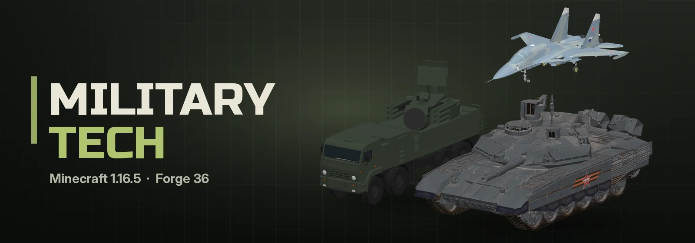</p>

<p align="center"><a href="README.md">English</a> | <b>Русский</b></p>

<p align="center">
  
  
  
  
  
</p>

<p align="center">
  <a href="https://discord.gg/YOUR_INVITE"></a>
  <a href="https://t.me/qwarwin4git"></a>
  <a href="mailto:qwarwin@gmail.com"></a>
</p>

Военная техника для Minecraft 1.16.5 на Forge 36: танки, БМП, реактивная и ствольная артиллерия, ПВО и самолёты.
Сделан для игры с друзьями, а не как симулятор: танк заряжается за несколько секунд, а самолёт летит 70 блоков в
секунду. Техника — настоящие 3D-модели с местами экипажа, интерьерами и рабочими кабинами.

## Галерея

<table>
  <tr>
    <td width="50%" align="center">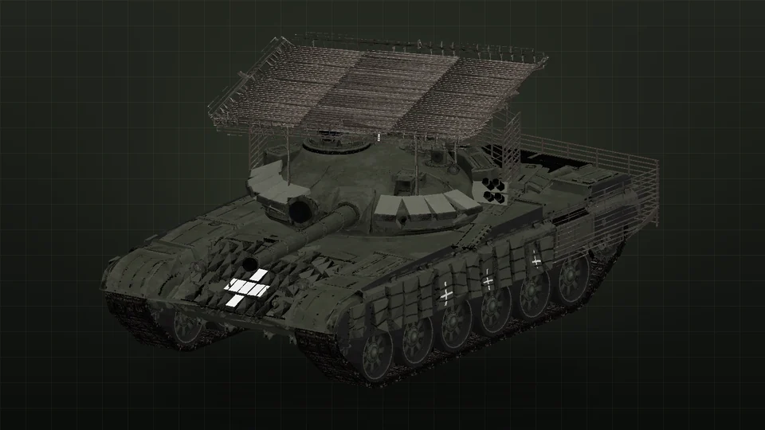<br><sub><b>Т-72Б3</b></sub></td>
    <td width="50%" align="center">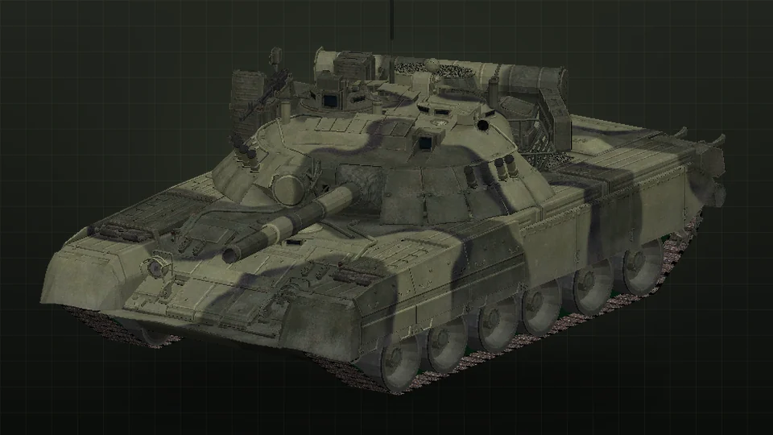<br><sub><b>Т-80У</b></sub></td>
  </tr>
  <tr>
    <td width="50%" align="center">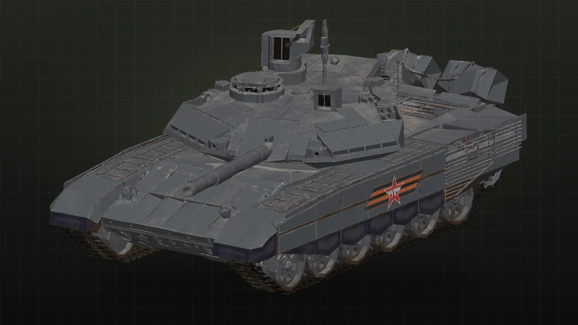<br><sub><b>Т-90М «Прорыв»</b></sub></td>
    <td width="50%" align="center">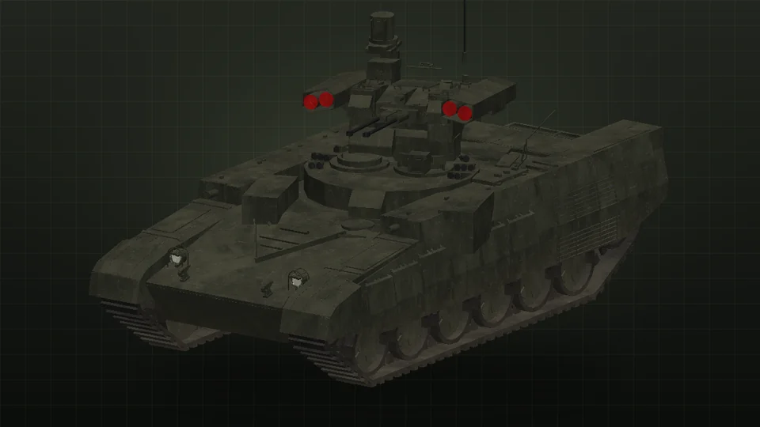<br><sub><b>БМПТ «Терминатор»</b></sub></td>
  </tr>
  <tr>
    <td width="50%" align="center">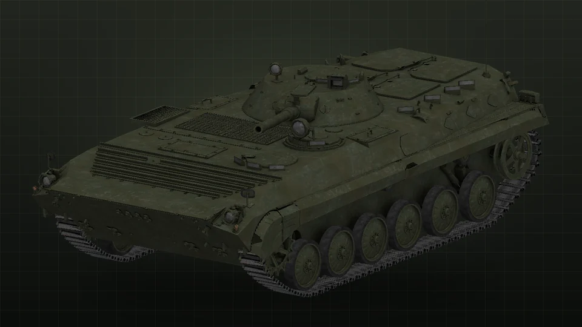<br><sub><b>БМП-1</b></sub></td>
    <td width="50%" align="center">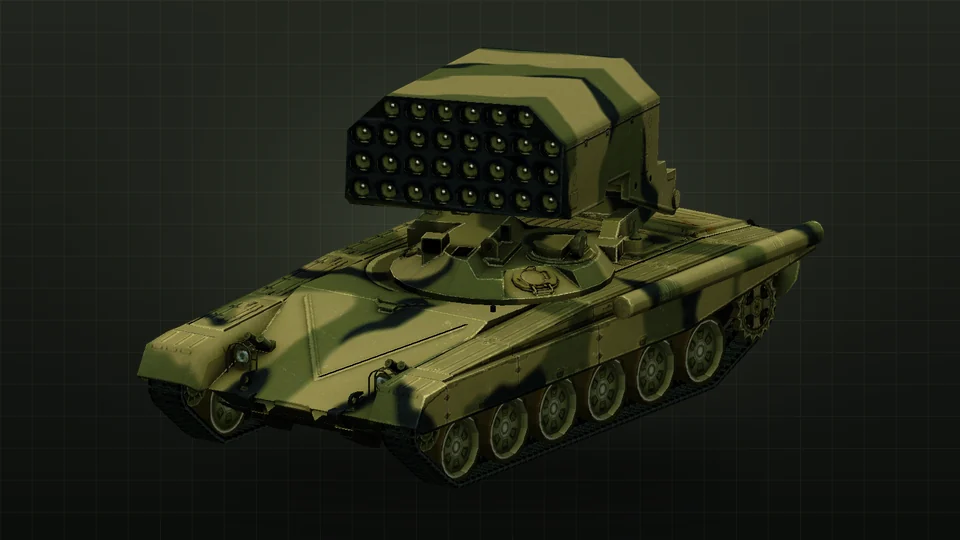<br><sub><b>ТОС-1А «Солнцепёк»</b></sub></td>
  </tr>
  <tr>
    <td width="50%" align="center">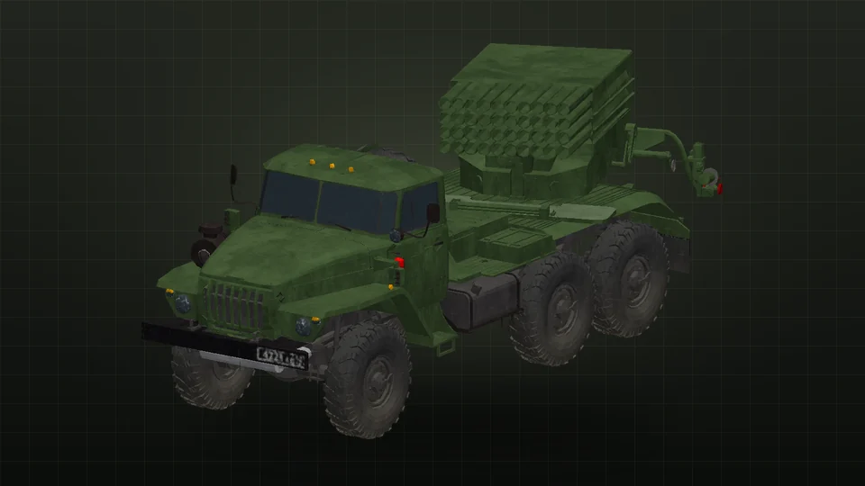<br><sub><b>БМ-21 «Град»</b></sub></td>
    <td width="50%" align="center">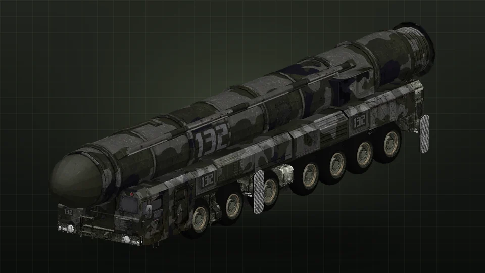<br><sub><b>«Орешник»</b></sub></td>
  </tr>
  <tr>
    <td width="50%" align="center">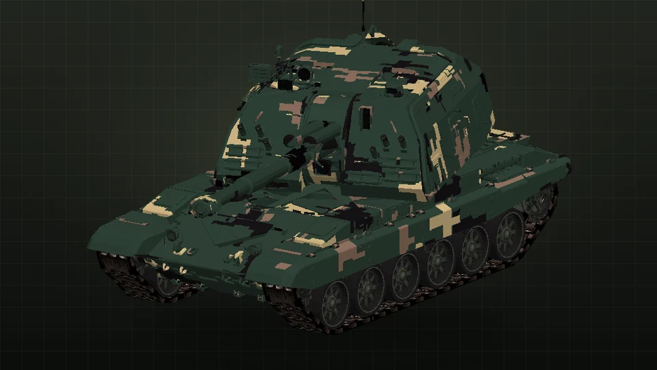<br><sub><b>2С19 «Мста-С»</b></sub></td>
    <td width="50%" align="center">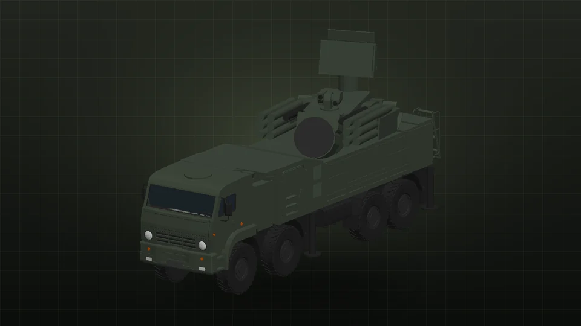<br><sub><b>«Панцирь-С1»</b></sub></td>
  </tr>
  <tr>
    <td width="50%" align="center">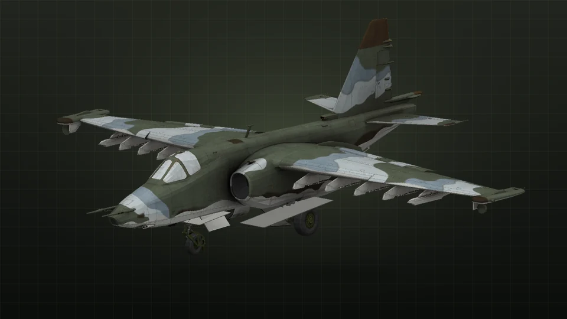<br><sub><b>Су-25</b></sub></td>
    <td width="50%" align="center">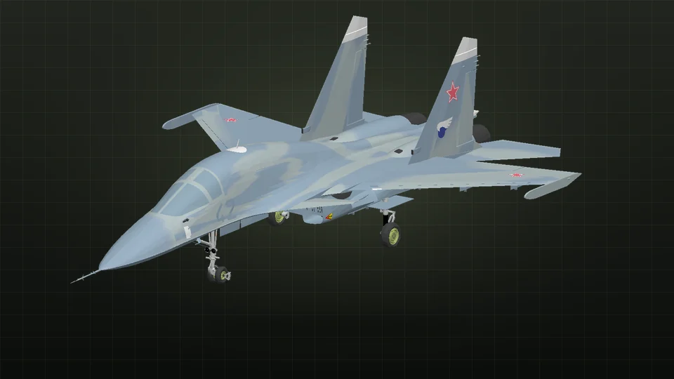<br><sub><b>Су-34</b></sub></td>
  </tr>
  <tr>
    <td width="50%" align="center">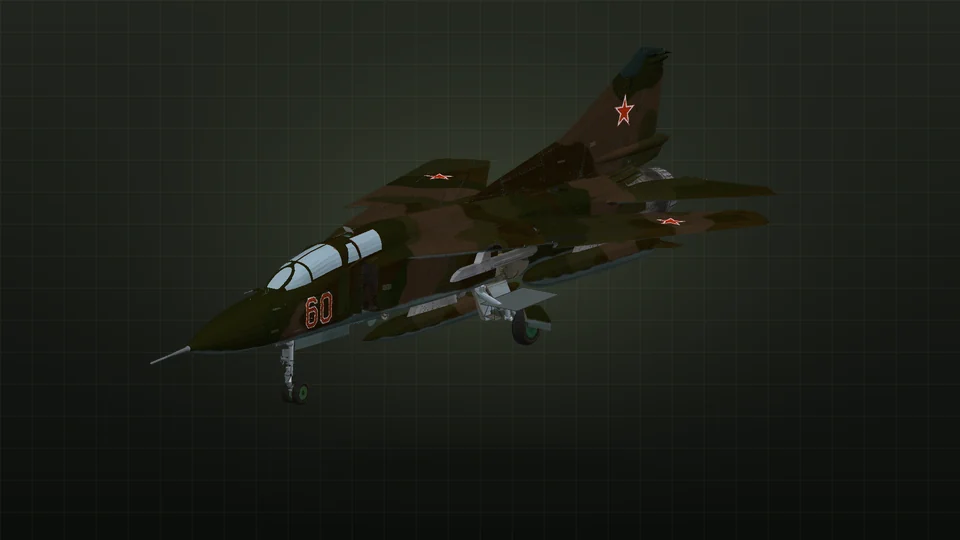<br><sub><b>МиГ-23УБ</b></sub></td>
    <td width="50%" align="center">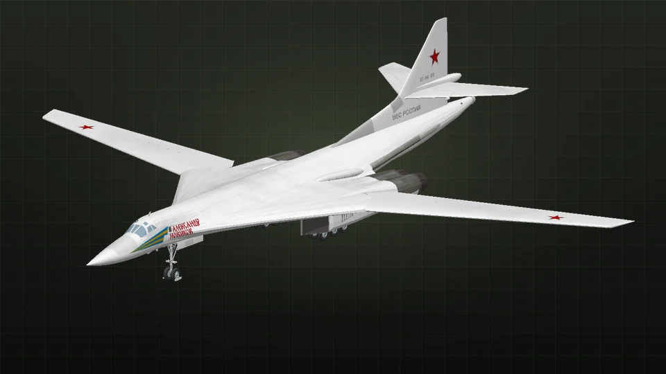<br><sub><b>Ту-160 «Белый лебедь»</b></sub></td>
  </tr>
</table>

## Что есть

### Танки и бронетехника

- **Т-72Б3.** 125 мм 2А46М-5: БОПС, ОФС и управляемая «Рефлекс», спаренный ПКТ, «Контакт-5».
- **Т-80У.** Газотурбинный, самый быстрый на гусеницах.
- **Т-90М «Прорыв».** «Реликт», решётки на башне, крепче всех и быстрее заряжается.
- **БМПТ «Терминатор».** Две 30-мм 2А42 и четыре ПТУР «Атака».
- **БМП-1.** 73 мм «Гром» и «Малютка» на направляющей, экипаж и десант внутри, ещё бойцы едут на крыше. Плавает.

У камеры есть третий вид — изнутри. Видно боевое отделение с местами экипажа, казёнником и каруселью, десант БМП,
кабины грузовиков; наружу смотришь через смотровые щели. На танках и БМПТ можно ехать на броне: броня таких не
защищает, зато они стреляют из своего оружия.

### Артиллерия

- **БМ-21 «Град»** на «Урале»: 40 реактивных снарядов, залпом (ЛКМ) или по одному (ПКМ), наводка вручную или по
  координатам (R).
- **ТОС-1А «Солнцепёк».** Пакет из 30 термобарических ракет на шасси Т-72, огонь по координатам. Термобар работает в
  две фазы, как настоящий: облако топлива расползается по земле, затекает в окопы, двери и окна и через секунду
  вспыхивает целиком. Внутри облака стены не спасают, снаружи бьёт ударная волна.
- **2С19 «Мста-С».** 152-мм САУ, только осколочно-фугасные, углы −4…+68°, огонь по координатам до ~3000 блоков.
  G переключает настильную и навесную стрельбу.
- **«Орешник»** на шасси МЗКТ: поднимаешь контейнер (G), задаёшь координаты (R), пускаешь (ЛКМ). Ракета уходит вверх,
  через несколько секунд на цель падают шесть раскалённых блоков, каждый делится на шесть суббоеприпасов.
- **Ядерная БЧ для «Орешника».** Отдельный предмет, ставится ПКМ по пусковой и выбирается в окне наведения. Вспышка,
  воронка, ударная волна, пожары, гриб и радиация у эпицентра; о пуске узнаёт весь сервер. Ящики с БК её не
  пополняют, размеры воронки и взрыва настраиваются.

### ПВО

- **«Панцирь-С1»** на КамАЗе: 12 ЗУР до 1800 блоков и спарка 30 мм. G — автоматический режим: сам находит и сбивает
  самолёты, дроны и ракеты.
- **Зенитная турель 2×30 мм.** Ставится на землю и работает сама: снаряды с дистанционным подрывом по чужим
  самолётам, ракетам и дронам в радиусе ~180 блоков. По маленькому шустрому дрону попасть трудно, по самолёту проще.
- **Зенитная ракетная турель.** 8 ЗУР, бьёт чужие самолёты до ~450 блоков (и Шахеды из FPV Drones).
- Своих турели не трогают: свои — это хозяин и его команда (`/team`). ПКМ — включить или выключить.

### Авиация

Управление «как в тундре»: самолёт летит туда, куда смотришь.

- **Су-25.** ГШ-30-2; подвески «Штурмовой», «НАР», «8×ФАБ-500», «Противотанковый» (Х-29Л).
- **Су-34.** ГШ-301; «Ударный» (Х-59, Х-29, ФАБ), «Тяжёлый» (ФАБ-1500) и **168 × С-8КО**.
- **МиГ-23УБ.** «Перехват» (Р-40 + Р-73), «Ближний бой» (4×Р-73), 4×ФАБ-500 или четыре блока Б-8.
- **Ту-160 «Белый лебедь».** Стратегический ракетоносец с внутренними отсеками: 12 крылатых Х-101, смесь с ядерными
  Х-102, ФАБ-3000/ФАБ-9000 или ковёр из 48 ФАБ-500. K в полёте — координаты цели, бомбовый прицел выводит на боевой
  курс.
- **Ка-52 «Аллигатор».** Ударный вертолёт соосной схемы в реальном размере, со своей физикой: винты раскручиваются,
  пробел — вверх, Ctrl — вниз, W/S — наклон вперёд/назад, A/D — вбок, мышь — разворот; отпустишь всё — зависнет.
  2А42 следит за прицелом, ПТУР «Атака» идут по лучу туда, куда смотришь. Подвески: «ПТУР» (12 «Атак» + 2 Б-8 + Р-73),
  «НАР» (4 Б-8 + Р-73), «Противотанковый» (24 «Атаки» + Р-73).

Боеприпасы: ФАБ-250, ФАБ-500, ФАБ-1500, ФАБ-3000, ФАБ-9000, ядерная бомба РН-28, С-8КО в блоках Б-8, УРВВ Р-73 и
Р-40 (захват перед пуском), Х-29Л (летит в точку, пока её держишь), Х-59 (выстрелил и забыл, бьёт в крышу), крылатые
Х-101 и ядерные Х-102. Любой груз вешается на любой пилон, если влезает по весу; вес отнимает скорость и
манёвренность. Сервер может запретить в конфиге любой боеприпас или все ядерные разом.

**Снаряжение пилота:** шлем ЗШ-7 с маской, лётная куртка, брюки и ботинки. Маска фильтрует радиоактивные осадки
(доза втрое меньше, с полным комплектом вшестеро) и даёт дышать под водой.

**Катапульта:** Shift в полёте — срабатывает кресло (К-36 в самолётах): сбрасывается фонарь, пилота выбрасывает
вверх, парашют кресла раскрывается сам. На Ка-52 — К-37-800: сначала отстреливаются лопасти. Экипаж сбитой в воздухе
машины катапультируется сам.

**Парашют Д-10:** ПКМ — надеть, у него отдельный слот на спине (виден на игроке). P в воздухе — раскрыть, P на земле —
снять; WASD — управление, после приземления он снова уложен.

**ОЗК:** противогаз, плащ, защитные чулки и боты. Полный комплект не пропускает ни радиацию, ни огонь — по эпицентру
ядерного взрыва можно ходить спокойно; один противогаз задерживает большую часть и даёт дышать под водой.

**«Ратник»:** шлем 6Б47, бронежилет 6Б45, брюки и берцы в «цифре»; защита как у железной брони, плюс плиты
ослабляют пули и осколки.

**Танковый шлемофон ТШ-4:** внутри техники снимает 40 % ударов.

## Управление

| | Танки и БМП | «Град» / «Орешник» / «Мста» | Самолёты |
|---|---|---|---|
| WASD | ехать | ехать | W/S тяга, A/D руль и руление на земле |
| Мышь | башня смотрит, куда смотришь | наводка пакета | курс: самолёт догоняет прицел |
| ЛКМ | пушка | залп / пуск / выстрел | пушка |
| ПКМ | ПКТ / ПТУР | одиночный снаряд | сброс / пуск выбранной подвески |
| R | сменить снаряд | ввод координат цели | следующий тип подвески |
| G | — | поднять / опустить пусковую, «Мста»: навесом | шасси |
| K | — | — | сменить подвеску (на земле), координаты цели (Ту-160) |
| C или F5 | снаружи / прицел / внутри | снаружи / прицел / кабина | снаружи / кабина |
| V | пересесть | пересесть | пересесть |
| Колёсико | зум в прицеле, дистанция камеры снаружи | | |
| Alt | свободный обзор | | свободный обзор |
| Shift | вылезти | вылезти | катапультироваться (в полёте) |
| P | парашют | парашют | парашют |

Взлёт: полная тяга (W), разгон по прямой, мышь вверх, когда скорость позволит, потом убрать шасси (G). Садиться на
выпущенное шасси, плавно и без крена, иначе машина разобьётся.

## Топливо, боекомплект и ремонт

- Техника из творческого режима ставится полностью заряженной.
- В выживании:
  - **Ящик с боекомплектом:** ПКМ по технике пополняет всё, что подходит. Заряжание снаряда, ракеты или бомбы
    занимает время и идёт только на стоящей технике.
  - **Бочка топлива:** ПКМ по технике — заправить; на ходу техника жжёт топливо.
  - **Ремкомплект:** чинит треть прочности.
  - **Гаечный ключ:** Shift+ПКМ по пустой технике — забрать её предметом вместе с прочностью и боезапасом.
- Все рецепты — в [RECIPES.md](RECIPES.md).

## Вместе с FPV Drones

Мод работает и сам по себе. Если стоит [FPV Drones](https://github.com/Qwarwin4/FpvWarMod):
- его дроны, Шахеды и ракеты — воздушные цели для Р-73/Р-40, турелей и неконтактных взрывателей;
- его грузовик, зенитка и «Корнет» поражаются здешним оружием, а его ПТУРы пробивают здешнюю броню.

Связка сделана через теги сущностей с необязательными записями: `data/militarytech/tags/entity_types/air_targets.json`
и `shootable.json`, туда можно дописать сущности из других модов.

## Настройки

`saves/<мир>/serverconfig/militarytech-server.toml`: разрушение блоков взрывами, урон осколками, урон по технике,
сила ФАБов, скорость наземной техники и авиации, топливо, время заряжания, ящики с БК, прогрузка чанков ракетами,
дальность «Орешника» и мощность суббоеприпасов, воронка, взрыв и время радиации ядерной БЧ, запрещённые боеприпасы
авиации.

## Сборка

Нужен JDK 17 (Gradle 7.6). Запусти `build.bat` (Windows) или `./build.sh` (Linux), готовый мод будет в
`build/libs/militarytech-<версия>.jar`.

## Модели, текстуры и звуки

Техника — настоящие 3D-модели, авторы и лицензии в [MODELS.md](MODELS.md). `tools/gen_meshes.py` упрощает сетку,
перепекает все текстуры модели в одну и режет её на корпус, башню и ствол (у самолётов — планер и шасси). Остальное
генерируется скриптами из `tools/`:

```
python3 tools/gen_all.py
```

Нужны Python 3 с numpy и Pillow, для звуков ещё ffmpeg с libvorbis. Карты деталей в `tools/detail/` сделаны из
CC0-текстур [ambientCG](https://ambientcg.com).

## Лицензия

Код — MIT. У 3D-моделей свои лицензии (CC BY 4.0), см. [MODELS.md](MODELS.md).
